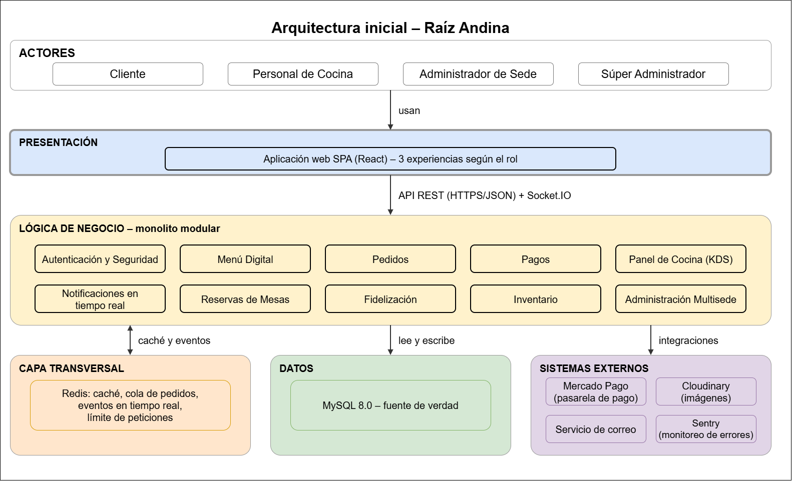

<div align="center">

# 🍲 Raíz Andina

### Sistema Integral de Pedidos y Gestión para una cadena de restaurantes con 3 sedes en Ayacucho


</div>

---

## 📑 Contenido

- [👤 Nombre](#-nombre)
- [📝 Descripción](#-descripción)
- [🏪 Caso de estudio](#-caso-de-estudio)
- [🎓 Curso](#-curso)
- [🎤 Material de exposición](#-material-de-exposición)
- [🏛️ Arquitectura en una mirada](#️-arquitectura-en-una-mirada)
- [⚖️ Decisiones arquitectónicas](#️-decisiones-arquitectónicas)
- [🗺️ Modelo C4](#️-modelo-c4)
- [🔗 Trazabilidad](#-trazabilidad)
- [📚 Documentación](#-documentación)
- [💻 Ejemplo de código Clean Architecture](#-ejemplo-de-código-clean-architecture)
- [📂 Estructura del repositorio](#-estructura-del-repositorio)
- [📖 Guías cubiertas](#-guías-cubiertas)

---

## 👤 Nombre

**Jhonatan Conde Taquiri**

---

## 📝 Descripción

Proyecto académico de Arquitectura de Software que documenta el análisis, la arquitectura y el diseño de **Raíz Andina**, un Sistema Integral de Pedidos y Gestión. El sistema digitaliza el recorrido completo de un pedido —desde que el cliente ve la carta hasta que paga y la cocina lo prepara— en las **3 sedes** de la cadena, soportando entre **500 y 1 000 usuarios conectados a la vez**.

📄 Detalle: [`00-necesidad-del-negocio.md`](docs/01-analisis-de-sistema/00-necesidad-del-negocio.md)

---

## 🏪 Caso de estudio

**Raíz Andina**, cadena de restaurantes con 3 sedes en Ayacucho. En las horas punta la cocina se atrasa, los pedidos se confunden y el cliente espera más de la cuenta.

### Actores

| Actor | Rol |
|---|---|
| 🧑 **Cliente** | Consulta la carta, arma su pedido, paga, reserva mesa y acumula puntos; puede comprar como invitado. |
| 👨‍🍳 **Personal de Cocina** | Prepara los pedidos desde el Panel de Cocina (KDS). |
| 🏪 **Administrador de Sede** | Gestiona el menú, los pedidos, el inventario y las reservas de su sede. |
| 🏢 **Súper Administrador** | Supervisa y gestiona las 3 sedes de forma consolidada. |

### Módulos (9 + 1 transversal)

| | | |
|---|---|---|
| 📋 Menú Digital | 🛒 Pedidos | 💳 Pagos |
| 👨‍🍳 Panel de Cocina (KDS) | 🔔 Notificaciones en tiempo real | 📅 Reservas de Mesas |
| ⭐ Fidelización | 📦 Inventario | 🏢 Administración Multisede |
| 🔐 **Autenticación y Seguridad** *(transversal)* | | |

---

## 🎓 Curso

| | |
|---|---|
| **Curso** | Arquitectura de Software (IS-488) |
| **Docente** | Ing. Lizbeth Jaico Quispe |
| **Universidad** | Universidad Nacional de San Cristóbal de Huamanga (UNSCH) |
| **Semestre** | 2026-II |

---

## 🎤 Material de exposición

| Material | Enlace |
|---|---|
| Presentación del primer sprint (PPT) | [Ver presentación en Google Drive](https://docs.google.com/presentation/d/1sWWWWQGgN21W1KONdTY7C1wc1pRqfiEO/edit?usp=sharing) |

---

## 🏛️ Arquitectura en una mirada

**Monolito modular en capas**, con enfoque **Clean Architecture** y comunicación cliente-servidor.



- **Una sola aplicación backend**, dividida por dentro en módulos con fronteras claras.
- **Sin estado en el servidor**: la sesión viaja en el token, así se pueden agregar réplicas detrás de un balanceador.
- **Redis** absorbe los picos: caché de la carta, cola de pedidos, eventos en tiempo real y límite de peticiones.
- **Lo externo se usa solo mediante adaptadores**: cambiar de pasarela de pago afecta un único archivo.

---

## ⚖️ Decisiones arquitectónicas

| ADR | Decisión |
|---|---|
| ADR-001 | Monolito modular en lugar de microservicios |
| ADR-002 | Clean Architecture como enfoque guía |
| ADR-003 | Caché de la carta en Redis |
| ADR-004 | Pagos mediante interfaces y adaptadores |
| ADR-005 | Autenticación con JWT y control de acceso por rol y sede |
| ADR-006 | Webhook de pagos sin duplicados y conciliación periódica |
| ADR-007 | Nombre y precio congelados al crear el pedido |
| ADR-008 | Tiempo real con Socket.IO y salas por sede y por pedido |
| ADR-009 | MySQL 8.0 como base de datos |
| ADR-010 | Aplicación web SPA |
| ADR-011 | API REST |

📄 Detalle: [`07-decisiones-arquitectonicas.md`](docs/01-analisis-de-sistema/07-decisiones-arquitectonicas.md)

---

## 🗺️ Modelo C4

| Nivel | Qué muestra | Documento |
|---|---|---|
| **1. Contexto** | Actores, el sistema y los sistemas externos | [Ver](docs/04-modelo-c4/Nivel1-DiagramadeContextodelSistema.md) |
| **2. Contenedores** | SPA, API, base de datos, Redis y procesador de tareas | [Ver](docs/04-modelo-c4/Nivel2-DiagramadeContenedores.md) |
| **3. Componentes** | Los módulos dentro de la API y sus relaciones | [Ver](docs/04-modelo-c4/Nivel3-Diagrama-de-Componentes.md) |
| **4. Código** | Clases del flujo pedido → pago → cocina | [Ver](docs/04-modelo-c4/Nivel4-DiagramadeCodigo.md) |


---

## 🔗 Trazabilidad

Cada componente del diseño se puede seguir hasta su origen:

```
Requisito (RF / AC)  →  Driver (DA)  →  Decisión (ADR)  →  Componente  →  Diagrama C4
```

**Ejemplo — módulo Pagos:**
`RF-PAG-01 a RF-PAG-06` y `AC06` → driver `DA03` → `ADR-004` (adaptador) y `ADR-006` (webhook sin duplicados) → componente **Pagos** → C4 niveles 3 y 4.

Las tablas de cada documento indican de qué requisitos y decisiones proviene cada componente.

---

## 📚 Documentación

| Sección | Documentos |
|---|---|
| **01 · Análisis del sistema** | [Necesidad del negocio](docs/01-analisis-de-sistema/00-necesidad-del-negocio.md) · [Actores](docs/01-analisis-de-sistema/01-actores.md) · [Historias de usuario](docs/01-analisis-de-sistema/02-historias-del-usuario.md) · [Requisitos funcionales](docs/01-analisis-de-sistema/03-requisitos-funcionales.md) · [Atributos de calidad](docs/01-analisis-de-sistema/04-atributos-de-calidad.md) · [Restricciones](docs/01-analisis-de-sistema/05-restricciones.md) · [Drivers](docs/01-analisis-de-sistema/06-driver-arquitectonicos.md) · [Decisiones (ADR)](docs/01-analisis-de-sistema/07-decisiones-arquitectonicas.md) · [Escenarios de calidad](docs/01-analisis-de-sistema/08-escenarios-atributos-calidad.md) |
| **02 · Arquitectura de software** | [Arquitectura inicial](docs/02-arquitectura-software/arquitectura-inicial.md) · [Estilo arquitectónico](docs/02-arquitectura-software/estilo-arquitectonico.md) · [Enfoque Clean Architecture](docs/02-arquitectura-software/enfoque-arquitectonico.md) · [Componentes](docs/02-arquitectura-software/componentes-arquitectonicos.md) |
| **03 · Diseño de software** | [Diseño interno de módulos](docs/03-diseno-de-software/diseno-interno/diseno-interno-de-modulos.md) · [Patrones de diseño](docs/03-diseno-de-software/diseno-interno/patrones-de-diseno.md) · [Principios de diseño (SOLID)](docs/03-diseno-de-software/diseno-interno/principios-de-diseno.md) |
| **04 · Modelo C4** | [Nivel 1](docs/04-modelo-c4/Nivel1-DiagramadeContextodelSistema.md) · [Nivel 2](docs/04-modelo-c4/Nivel2-DiagramadeContenedores.md) · [Nivel 3](docs/04-modelo-c4/Nivel3-Diagrama-de-Componentes.md) · [Nivel 4](docs/04-modelo-c4/Nivel4-DiagramadeCodigo.md) |
| **Tecnología** | [Tecnologías y ejemplo de código](tecnologia/README.md) |

> Todos los diagramas están hechos en **Draw.io**: las imágenes PNG están en [`img/`](img) y sus archivos fuente en [`img/fuentes-svg/`](img/fuentes-svg).

---

## 💻 Ejemplo de código Clean Architecture

En [`tecnologia/ejemplo-clean-architecture`](tecnologia/ejemplo-clean-architecture) hay un **ejemplo didáctico** en Python del flujo pedido → pago → cocina, separado en las capas **dominio**, **aplicación**, **infraestructura** y **presentación**. Demuestra que se puede cambiar de pasarela de pago sin tocar las reglas del negocio.

```bash
cd tecnologia/ejemplo-clean-architecture
python demo.py
```

---

## 📂 Estructura del repositorio

```
RaizAndina-arquitSoft-jhonatanconde/
├── docs/
│   ├── 01-analisis-de-sistema/
│   │   ├── 00-necesidad-del-negocio.md
│   │   ├── 01-actores.md
│   │   ├── 02-historias-del-usuario.md
│   │   ├── 03-requisitos-funcionales.md
│   │   ├── 04-atributos-de-calidad.md
│   │   ├── 05-restricciones.md
│   │   ├── 06-driver-arquitectonicos.md
│   │   ├── 07-decisiones-arquitectonicas.md
│   │   └── 08-escenarios-atributos-calidad.md
│   ├── 02-arquitectura-software/
│   │   ├── arquitectura-inicial.md
│   │   ├── estilo-arquitectonico.md
│   │   ├── enfoque-arquitectonico.md
│   │   └── componentes-arquitectonicos.md
│   ├── 03-diseno-de-software/
│   │   └── diseno-interno/
│   │       ├── diseno-interno-de-modulos.md
│   │       ├── patrones-de-diseno.md
│   │       └── principios-de-diseno.md
│   └── 04-modelo-c4/
│       ├── Nivel1-DiagramadeContextodelSistema.md
│       ├── Nivel2-DiagramadeContenedores.md
│       ├── Nivel3-Diagrama-de-Componentes.md
│       └── Nivel4-DiagramadeCodigo.md
├── img/
│   ├── *.png          (los 10 diagramas)
│   └── fuentes-svg/   (archivos fuente .drawio)
├── tecnologia/
│   ├── README.md
│   └── ejemplo-clean-architecture/
├── .gitignore
└── README.md
```

---

## 📖 Guías cubiertas

| Guía | Contenido |
|---|---|
| **Guía 01-02** | Análisis del sistema: actores, historias de usuario, requisitos, atributos de calidad, restricciones, drivers y arquitectura inicial. |
| **Guía 03** | Decisiones arquitectónicas (ADR), estilo arquitectónico y enfoque Clean Architecture. |
| **Guía 04** | Primer sprint: necesidad del negocio, escenarios de atributos de calidad, componentes, diseño interno (módulos, patrones y principios), modelo C4 (niveles 1 a 4) y ejemplo de código del enfoque Clean Architecture. |