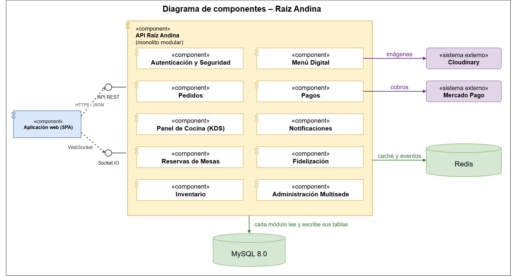

# Componentes arquitectónicos

## Diagrama de componentes

## Descripción

El contenedor **API Raíz Andina** (monolito modular en capas) recibe las peticiones de la aplicación web por su **API REST** y por el canal **Socket.IO**, y las reparte entre sus módulos. Cada módulo lee y escribe sus propias tablas en **MySQL**. **Redis** se usa para la caché de la carta, el límite de intentos de inicio de sesión, la revocación de tokens, el canal de eventos entre réplicas y las tareas en segundo plano. Solo el módulo **Pagos** habla con **Mercado Pago** y solo **Menú Digital** con **Cloudinary**, de modo que cambiar de proveedor afecta a un único módulo.

## Responsabilidad de cada componente

| Componente | Responsabilidad | Requisitos origen | ADR |
|---|---|---|---|
| Autenticación y Seguridad | Registro, inicio y cierre de sesión, token con rol y sede, control de acceso por sede y límite de intentos. | RF-AUT-01 a RF-AUT-08, AC05 | ADR-005 |
| Menú Digital | Carta por sede y categorías, gestión de productos, fotos y marcar agotado. | RF-MEN-00 a RF-MEN-11 | ADR-003, ADR-004, ADR-007 |
| Pedidos | Carrito, modalidad delivery o recojo, estados del pedido y tiempo estimado. | RF-PED-01 a RF-PED-11 | ADR-007 |
| Pagos | Cobro con Mercado Pago, confirmación por webhook sin duplicados, conciliación periódica y paso del pedido a cocina. | RF-PAG-01 a RF-PAG-06, AC06 | ADR-004, ADR-006 |
| Panel de Cocina (KDS) | Tablero de pedidos pagados por estado y avance con un toque. | RF-KDS-01 a RF-KDS-06, AC08 | ADR-008 |
| Notificaciones | Eventos en tiempo real por sede y por pedido. | RF-NOT-01 a RF-NOT-06, AC03 | ADR-008 |
| Administración Multisede | Sedes, cuentas del personal, parámetros del sistema, auditoría, dashboard y reportes. | RF-ADM-01 a RF-ADM-06 | ADR-005 |
| Reservas de Mesas | Disponibilidad, reserva de mesa y lista de espera. | RF-RES-01 a RF-RES-08 | ADR-001 |
| Fidelización | Puntos, niveles y cupones. | RF-FID-01 a RF-FID-05 | ADR-001 |
| Inventario | Insumos, recetas y descuento automático de stock. | RF-INV-01 a RF-INV-07 | ADR-001 |