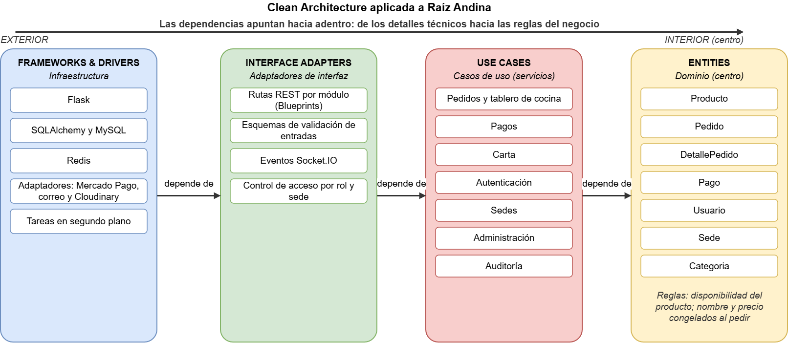

# Enfoque arquitectónico: Clean Architecture

| Elemento | Descripción aplicada a Raíz Andina |
|---|---|
| Patrón / enfoque arquitectónico | Clean Architecture (Arquitectura Limpia). |
| Objetivo | Separar las reglas del negocio de los detalles tecnológicos y controlar que las dependencias apunten siempre hacia el dominio. |
| ¿Qué problema resuelve? | Evita que las reglas de pedidos, pagos o menú queden atadas a Flask, SQLAlchemy, Mercado Pago o Cloudinary: cambiar de proveedor o de framework afecta solo su adaptador y su servicio, no el resto del sistema (DA06). |
| Capas definidas | Dominio (entidades), Aplicación (casos de uso), Adaptadores de interfaz e Infraestructura (frameworks y drivers). |
| Beneficios | Facilita el mantenimiento y las pruebas; permite cambiar implementaciones técnicas (por ejemplo, la pasarela de pago) sin reescribir las reglas del negocio; mejora la separación de responsabilidades. |

## Mapeo de capas en Raíz Andina

| Capa (Clean Architecture) | Qué contiene | Equivalente en Raíz Andina |
|---|---|---|
| Entities (Dominio) | Reglas de negocio fundamentales | Entidades `Producto`, `Pedido`, `DetallePedido`, `Pago`, `Usuario`, `Sede` y `Categoria`, entre otras. Reglas como la disponibilidad del producto o congelar nombre y precio al pedir. |
| Use Cases (Aplicación) | Reglas específicas de cada operación | Servicios por módulo: pedidos y tablero de cocina, pagos, carta, autenticación, sedes, administración y auditoría. |
| Interface Adapters | Traducen entre el exterior y el dominio | Rutas REST por módulo (Blueprints de Flask), esquemas de validación de las entradas, eventos Socket.IO y control de acceso por rol y sede. |
| Frameworks & Drivers (Infraestructura) | Detalles técnicos externos | Flask, SQLAlchemy y MySQL, Redis, adaptadores de Mercado Pago, correo y Cloudinary, y tareas en segundo plano. |

## Diagrama de capas

**Regla de dependencia:** las dependencias de código apuntan siempre hacia el centro. El Dominio no conoce Flask, SQLAlchemy, Mercado Pago ni Cloudinary; los casos de uso conocen el dominio y piden lo externo a través de un adaptador; los detalles tecnológicos quedan en la capa exterior.

## Clean Architecture frente a Arquitectura Hexagonal

| Criterio | Clean Architecture | Arquitectura Hexagonal (puertos y adaptadores) |
|---|---|---|
| Idea central | Capas concéntricas con la regla de dependencia: lo de afuera depende de lo de adentro. | El núcleo de la aplicación se comunica con el exterior solo a través de puertos, implementados por adaptadores. |
| Organización | Cuatro capas: entidades, casos de uso, adaptadores de interfaz e infraestructura. | Núcleo (dominio y aplicación) y un anillo de puertos y adaptadores, sin capas internas obligatorias. |
| Parecido | Ambas aíslan las reglas del negocio de la tecnología y permiten cambiar la base de datos, la interfaz o un proveedor sin tocar el núcleo. | Ambas aíslan las reglas del negocio de la tecnología y permiten cambiar la base de datos, la interfaz o un proveedor sin tocar el núcleo. |
| Diferencia principal | Prescribe más estructura interna (entidades separadas de los casos de uso). | Es más liviana: se centra en el borde del sistema (puertos de entrada y de salida). |
| Encaje con Raíz Andina | Elegida: la separación entre rutas, servicios y modelos se corresponde con sus capas, y permite aislar al proveedor de pagos. | Los adaptadores de Mercado Pago, Cloudinary y correo siguen la idea de "adaptador" de este enfoque; se aplica ese criterio dentro de la capa de infraestructura. |

**Decisión (ADR-002):** se adopta Clean Architecture como enfoque guía por su separación explícita entre entidades y casos de uso, y se incorpora de la arquitectura hexagonal el criterio de acceder a los servicios externos solo mediante adaptadores (ADR-004).