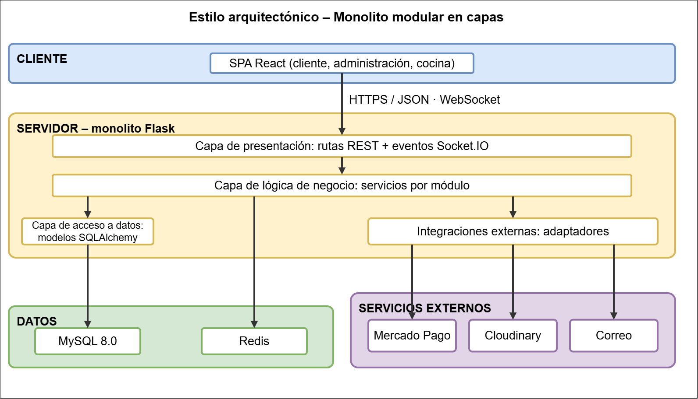

# Estilo arquitectónico

**Estilo seleccionado:** Monolito modular, con arquitectura en capas y comunicación cliente-servidor.

## Por qué este estilo

| Driver | Cómo lo atiende el estilo |
|---|---|
| DA05 – Modificabilidad (crecer de un conjunto inicial a 9 módulos) | Una sola aplicación backend desplegable y un solo repositorio, con módulos de fronteras claras, permiten crecer hasta los 9 módulos sin la complejidad operativa de varios servicios. |
| DA01 – 500 a 1 000 usuarios conectados | El backend no guarda estado en memoria (la sesión viaja en el token), por lo que se pueden agregar réplicas del mismo monolito detrás de un balanceador. |
| DA03 – Pagos asíncronos e integridad | Operaciones como "confirmar pago + liberar el pedido a cocina" se resuelven en una sola transacción de base de datos, algo que en microservicios exigiría coordinación distribuida. |
| DA06 – Modificabilidad (cambio de proveedor) | Cada responsabilidad vive en su capa (rutas, servicios, modelos, integraciones), así un cambio de proveedor o de regla afecta pocos archivos. |

## Vista en capas

**Regla del estilo:** cada capa solo se comunica con la inmediatamente inferior. Las rutas no hablan con la base de datos: llaman a un servicio, y es el servicio quien usa los modelos o los adaptadores.

## Alternativas descartadas

| Alternativa | Motivo del descarte |
|---|---|
| Microservicios | Operar varios servicios, sus despliegues y su comunicación agrega una complejidad que un sistema de 3 sedes no necesita. Además, "pedido + pago + stock" necesita una sola transacción. |
| Cliente-servidor sin separación en capas | Mezclar rutas, reglas de negocio y acceso a datos en un mismo archivo hace difícil modificar un módulo sin afectar a otros (DA06). |

## Consecuencias

- **A favor:** despliegue simple, transacciones locales, un solo lugar donde buscar el código y menor costo de mantenimiento.
- **En contra:** todos los módulos se despliegan juntos y comparten recursos; si un módulo crece demasiado podría necesitar extraerse como servicio en el futuro, para lo cual las fronteras entre módulos ya están definidas.