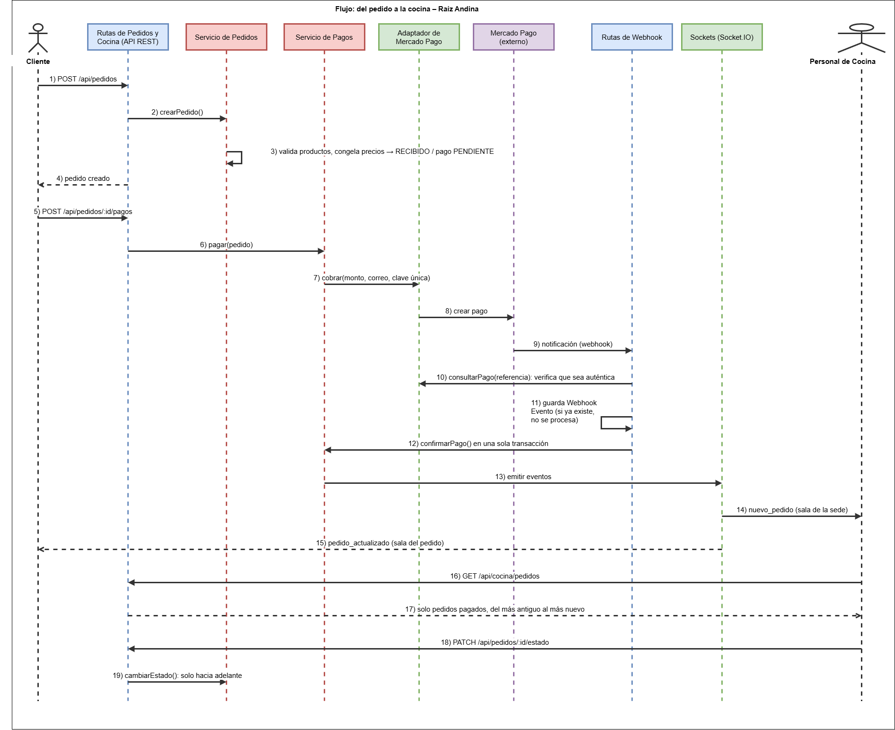
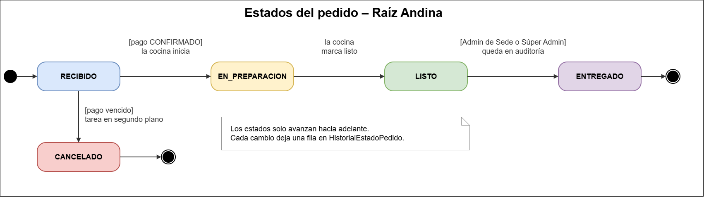

# Diseño interno de módulos

> Detalle del diseño interno del flujo central del sistema: **pedido → pago → cocina**.

## Organización interna del backend

| Carpeta | Contenido |
|---|---|
| `routes/` | API REST, un Blueprint por módulo: pedidos, cocina, webhooks, carta, autenticación, sedes, usuarios y administración. |
| `schemas/` | Validación de los datos de entrada. |
| `services/` | Reglas de negocio de cada módulo: pedidos y cocina (KDS), pagos, carta, autenticación, sedes, administración y auditoría. |
| `models/` | Entidades SQLAlchemy: Pedido, DetallePedido, HistorialEstadoPedido, Pago, WebhookEvento, Producto, Categoría, Usuario, Sede, Parámetro y Auditoría, entre otras. |
| `integrations/` | Adaptadores de los servicios externos: Mercado Pago, correo y Cloudinary. |
| `jobs/` | Tareas en segundo plano. |
| `sockets` | Eventos y salas de Socket.IO. |
| `utils/` | Control de acceso por rol y sede. |

## Componentes por capa y responsabilidad

| Capa | Componente | Responsabilidad |
|---|---|---|
| Rutas | Rutas de Pedidos | Recibe `POST /api/pedidos` y `PATCH /api/pedidos/:id/estado`, aplica el control de acceso y llama al servicio. |
| Rutas | Rutas de Cocina | Expone `GET /api/cocina/pedidos` para el Panel de Cocina, limitado a la sede de quien consulta. |
| Rutas | Rutas de Webhook | Recibe la notificación de Mercado Pago, comprueba que sea auténtica y evita procesarla dos veces. |
| Validación | Esquemas de entrada | Revisan el formato de los datos antes de que lleguen a las reglas de negocio. |
| Servicios | Servicio de Pedidos | Crea el pedido con precios congelados, calcula el tiempo estimado, cambia el estado (solo hacia adelante), arma la lista de la cocina y emite los eventos en tiempo real. |
| Servicios | Servicio de Pagos | Registra el cobro en Mercado Pago, confirma el pago y avisa al Panel de Cocina. |
| Servicios | Servicio de Auditoría | Registra quién hizo qué cambio, sin bloquear la operación si el registro falla. |
| Modelos | Pedido, DetallePedido, Pago, WebhookEvento | Guardan los datos; el producto sabe si está disponible. |
| Integraciones | Adaptador de Mercado Pago | Habla con Mercado Pago y traduce sus estados al vocabulario del sistema (aprobado, fallido, pendiente). |
| Transversal | Sockets | Une a los clientes a sus salas y emite los eventos. |
| Transversal | Control de acceso | Protege cada ruta por rol y limita los datos a la sede del token. |
| Tareas | Cancelación de pedidos vencidos | Cancela los pedidos cuyo pago venció. |

## Regla de dependencias

| Desde | Hacia | ¿Permitido? |
|---|---|---|
| Rutas | Servicios, validación, control de acceso | Sí: la ruta solo orquesta la petición. |
| Servicios | Modelos, adaptadores, Socket.IO | Sí: aquí viven las reglas de negocio. |
| Adaptadores | Servicios o rutas | No: el adaptador solo conoce a su proveedor externo. |
| Modelos | Servicios o rutas | No: el modelo solo conoce la base de datos. |

La petición entra por las rutas, las reglas están en los servicios y los datos en los modelos. Los servicios acceden a los proveedores externos solo a través de su adaptador (ADR-004).

## Flujo: del pedido a la cocina

| Paso | Mensajes del diagrama | Qué pasa | Dónde ocurre | Requisito |
|---|---|---|---|---|
| 1 | 1 a 4 | Se valida que todos los productos estén disponibles y sean de la sede, se congelan nombre y precio, se calcula el total y se crea el pedido en `RECIBIDO` con pago `PENDIENTE`. | Servicio de Pedidos | RF-PED-01 a 03 |
| 2 | 5 a 8 | El cliente paga; el servidor define el monto y el correo (lo que mande el cliente se ignora) y envía un identificador único para que un reintento no cobre dos veces. | Servicio de Pagos, Adaptador de Mercado Pago | RF-PAG-01 |
| 3 | 9 y 10 | Mercado Pago avisa por webhook. Se consulta el pago en Mercado Pago para confirmar que la notificación es auténtica. | Rutas de Webhook | RF-PAG-02 |
| 4 | 11 | Se guarda el identificador de la notificación (único); si ya existía, no se procesa de nuevo. | WebhookEvento | RF-PAG-02, ADR-006 |
| 5 | 12 | En una sola transacción se confirma el pago y el pedido queda listo para la cocina. | Servicio de Pagos | RF-PAG-03 |
| 6 | 13 a 15 | Se emiten los eventos: `pedido_actualizado` a la sala del pedido y a la de la sede, y `nuevo_pedido` solo al Panel de Cocina. | Sockets, Servicio de Pedidos | RF-NOT-01, ADR-008 |
| 7 | 16 y 17 | La cocina ve solo pedidos pagados, del más antiguo al más nuevo, sin precios ni datos de pago. | Rutas de Cocina, Servicio de Pedidos | RF-KDS-01, 02, 04 |
| 8 | 18 y 19 | La cocina avanza el pedido con un toque; solo el Administrador de Sede o el Súper Administrador pueden marcarlo como `ENTREGADO`, y eso queda en la auditoría. | Servicio de Pedidos, Servicio de Auditoría | RF-KDS-03, 06 |

## Estados del pedido

Los estados solo avanzan hacia adelante y cada cambio deja una fila en el historial de estados del pedido. Si el pago vence, la tarea de cancelación pasa el pedido de `RECIBIDO` a `CANCELADO`.