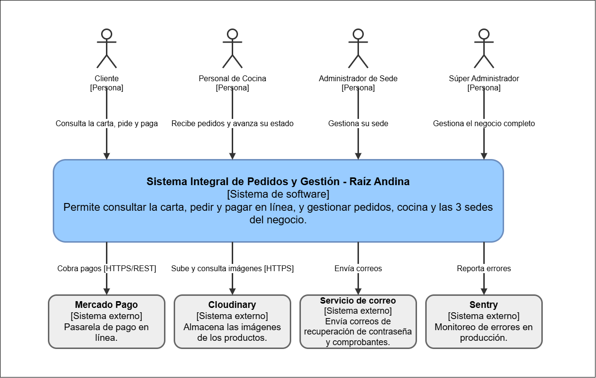

# Nivel 1 · Diagrama de contexto del sistema

> **Proyecto:** Raíz Andina · **Modelo:** C4 · Nivel 1 de 4

## 1. Objetivo

Mostrar el Sistema Integral de Pedidos y Gestión de Raíz Andina como una sola caja: quiénes lo usan y con qué sistemas externos se comunica.

| Aspecto | Descripción |
|---|---|
| Pregunta que responde | ¿Qué es el sistema, quién lo usa y con quién se integra? |
| Audiencia | Todos: docente, equipo, cualquier persona sin conocimiento técnico |
| Qué no muestra | Tecnologías, servidores, bases de datos ni módulos internos |
| Siguiente nivel | `Nivel2-DiagramadeContenedores.md` |

## 2. Diagrama

## 3. Personas

| Persona | Qué hace en el sistema | Requisitos relacionados |
|---|---|---|
| Cliente | Consulta la carta de su sede, arma el carrito, pide (delivery o recojo), paga en línea, sigue el estado de su pedido, reserva mesa y acumula puntos. | RF-MEN, RF-PED, RF-PAG, RF-NOT, RF-RES, RF-FID |
| Personal de Cocina | Recibe solo los pedidos pagados en el Panel de Cocina y avanza su estado. | RF-KDS, RF-NOT |
| Administrador de Sede | Gestiona su sede: productos, inventario, reservas y pedidos. | RF-MEN, RF-INV, RF-RES, RF-ADM |
| Súper Administrador | Gestiona las 3 sedes: sedes, cuentas, parámetros del sistema y reportes consolidados. | RF-ADM, RF-AUT |

El detalle de cada actor está en `docs/01-analisis-de-sistema/01-actores.md`.

## 4. Sistemas externos

| Sistema externo | Para qué se usa | Protocolo | Origen |
|---|---|---|---|
| Mercado Pago | Cobro en línea y notificación del resultado del pago (webhook). | HTTPS/REST | RC05, ADR-004 |
| Cloudinary | Almacenamiento de las imágenes de los productos. | HTTPS | RC05 |
| Servicio de correo | Envío de correos de recuperación de contraseña y comprobantes. | Correo electrónico | RF-AUT |
| Sentry | Monitoreo de errores en producción. | HTTPS | AC09, EQ-09 |

## 5. Alcance del sistema

El sistema cubre el recorrido completo del pedido en las 3 sedes: carta, pedido, pago y cocina, más reservas, fidelización, inventario y administración multisede. Los cuatro sistemas externos de la tabla anterior son los únicos con los que se comunica.