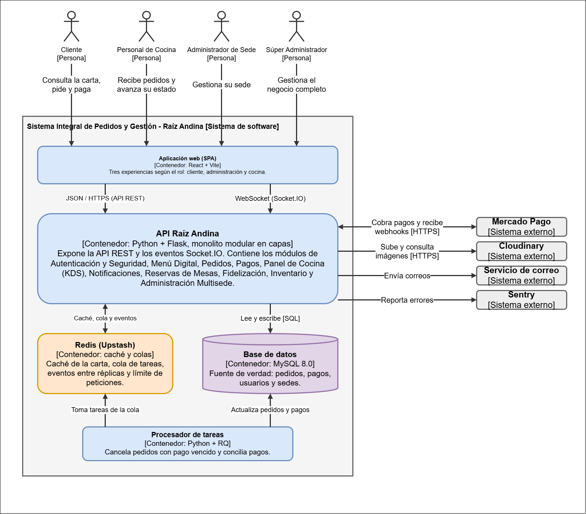

# Nivel 2 · Diagrama de contenedores

> **Proyecto:** Raíz Andina · **Modelo:** C4 · Nivel 2 de 4

## 1. Objetivo

Abrir la caja "Sistema Integral de Pedidos y Gestión" del nivel 1 y mostrar las aplicaciones y almacenes de datos que la componen.

| Aspecto | Descripción |
|---|---|
| Pregunta que responde | ¿De qué piezas ejecutables se compone el sistema y con qué tecnología? |
| Nivel anterior | `Nivel1-DiagramadeContextodelSistema.md` |
| Siguiente nivel | `Nivel3-Diagrama-de-Componentes.md` |

## 2. Diagrama

## 3. Contenedores

| Contenedor | Tecnología | Responsabilidad | Origen |
|---|---|---|---|
| Aplicación web (SPA) | React, Vite, Tailwind y GSAP | Tres experiencias según el rol: cliente, administración y cocina. Consume la API REST y el canal Socket.IO. | RC02, RC07, ADR-010 |
| API Raíz Andina | Python, Flask, SQLAlchemy y Flask-JWT-Extended | Monolito modular en capas: expone la API REST y los eventos Socket.IO, y contiene los módulos del negocio. | RC01, RC06, RC09, ADR-001, ADR-002, ADR-011 |
| Redis (Upstash) | Redis | Caché de la carta, cola de tareas, eventos entre réplicas, límite de peticiones y revocación de tokens. | RC04, ADR-003, ADR-008 |
| Base de datos | MySQL 8.0 | Fuente de verdad: pedidos, pagos, usuarios, sedes y demás datos del negocio. | RC03, ADR-009 |
| Procesador de tareas | Python y RQ | Cancela los pedidos con pago vencido y concilia los pagos cuyo webhook no llegó. | RC04, ADR-006 |

## 4. Relaciones

| Origen | Destino | Protocolo | Para qué |
|---|---|---|---|
| Personas | Aplicación web | HTTPS | Usan la experiencia que corresponde a su rol. |
| Aplicación web | API Raíz Andina | HTTPS / JSON (API REST) | Consultas y operaciones del negocio. |
| Aplicación web | API Raíz Andina | WebSocket (Socket.IO) | Estado del pedido en tiempo real. |
| API Raíz Andina | Base de datos | SQL | Lee y escribe los datos. |
| API Raíz Andina | Redis | Protocolo de Redis | Caché, cola de tareas y eventos. |
| Procesador de tareas | Redis | Protocolo de Redis | Toma las tareas de la cola. |
| Procesador de tareas | Base de datos | SQL | Actualiza pedidos y pagos. |
| API Raíz Andina | Mercado Pago | HTTPS/REST | Cobra pagos y recibe los webhooks. |
| API Raíz Andina | Cloudinary | HTTPS | Sube y consulta imágenes. |
| API Raíz Andina | Servicio de correo | Correo electrónico | Envía correos. |
| API Raíz Andina | Sentry | HTTPS | Reporta errores. |

## 5. Decisiones que se ven en este nivel

| Decisión | Dónde se ve |
|---|---|
| Monolito modular (ADR-001) | Un solo contenedor de API con todos los módulos, en lugar de varios servicios. |
| Una sola aplicación web con tres experiencias (ADR-010) | Un solo contenedor de frontend. |
| Base de datos única como fuente de verdad (ADR-009) | MySQL guarda todo lo importante; Redis solo guarda información reconstruible. |
| Escalado con réplicas (EQ-02) | La API no guarda estado en memoria, por lo que se pueden agregar réplicas detrás de un balanceador. |