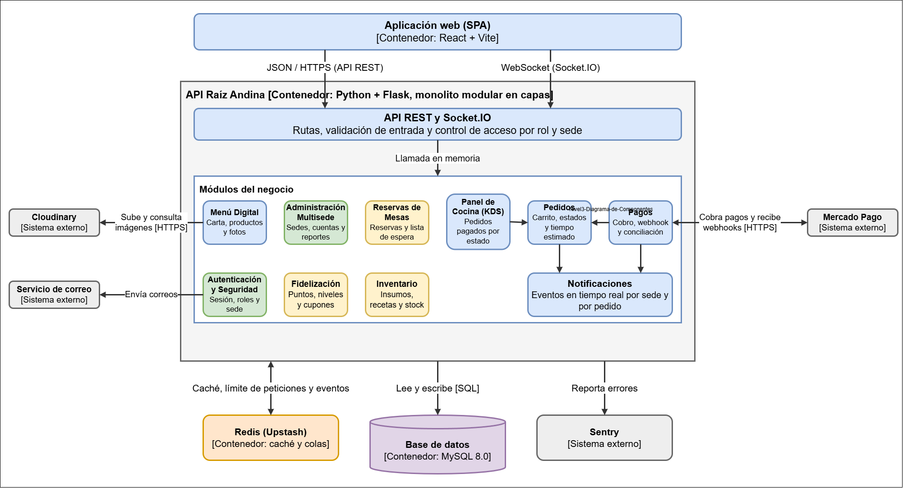

# Nivel 3 · Diagrama de componentes

> **Proyecto:** Raíz Andina · **Contenedor detallado:** API Raíz Andina · **Modelo:** C4 · Nivel 3 de 4

## 1. Objetivo

Abrir el contenedor API Raíz Andina y mostrar sus módulos internos.

| Aspecto | Descripción |
|---|---|
| Nivel anterior | `Nivel2-DiagramadeContenedores.md` |
| Siguiente nivel | `Nivel4-DiagramadeCodigo.md` |
| Vista complementaria | `docs/02-arquitectura-software/componentes-arquitectonicos.md` |

## 2. Diagrama

## 3. Componentes

| Componente | Responsabilidad | Requisitos relacionados | ADR |
|---|---|---|---|
| API REST y Socket.IO | Punto de entrada: rutas, validación de entrada y control de acceso por rol y sede. | RC09, AC05 | ADR-005, ADR-011 |
| Autenticación y Seguridad | Registro, inicio y cierre de sesión, token con rol y sede, control de acceso por sede y límite de intentos. | RF-AUT-01 a RF-AUT-08, AC05 | ADR-005 |
| Menú Digital | Carta por sede y categorías, gestión de productos, fotos y marcar agotado. | RF-MEN-00 a RF-MEN-11 | ADR-003, ADR-004, ADR-007 |
| Pedidos | Carrito, modalidad delivery o recojo, estados del pedido y tiempo estimado. | RF-PED-01 a RF-PED-11 | ADR-007 |
| Pagos | Cobro con Mercado Pago, confirmación por webhook sin duplicados, conciliación periódica y paso del pedido a cocina. | RF-PAG-01 a RF-PAG-06, AC06 | ADR-004, ADR-006 |
| Panel de Cocina (KDS) | Tablero de pedidos pagados por estado y avance con un toque. | RF-KDS-01 a RF-KDS-06, AC08 | ADR-008 |
| Notificaciones | Eventos en tiempo real por sede y por pedido. | RF-NOT-01 a RF-NOT-06, AC03 | ADR-008 |
| Administración Multisede | Sedes, cuentas del personal, parámetros del sistema, auditoría, dashboard y reportes. | RF-ADM-01 a RF-ADM-06 | ADR-005 |
| Reservas de Mesas | Disponibilidad, reserva de mesa y lista de espera. | RF-RES-01 a RF-RES-08 | ADR-001 |
| Fidelización | Puntos, niveles y cupones. | RF-FID-01 a RF-FID-05 | ADR-001 |
| Inventario | Insumos, recetas y descuento automático de stock. | RF-INV-01 a RF-INV-07 | ADR-001 |

## 4. Relaciones entre componentes

| Origen | Destino | Tipo de comunicación |
|---|---|---|
| API REST y Socket.IO | Todos los módulos | Llamada en memoria |
| Pagos | Pedidos | Llamada en memoria (confirma el pago del pedido) |
| Panel de Cocina (KDS) | Pedidos | Llamada en memoria (lee los pedidos pagados) |
| Pedidos | Notificaciones | Llamada en memoria (avisa los cambios de estado) |
| Pagos | Notificaciones | Llamada en memoria (avisa el pago confirmado) |
| Todos los módulos | Autenticación y Seguridad | Llamada en memoria (identidad, rol y sede) |

## 5. Relaciones con otros contenedores y sistemas externos

| Componente | Destino | Protocolo | Patrón aplicado |
|---|---|---|---|
| Autenticación y Seguridad | Redis | Protocolo de Redis | Límite de peticiones y revocación de tokens |
| Menú Digital | Redis | Protocolo de Redis | Caché de la carta |
| Notificaciones | Redis | Protocolo de Redis | Canal de eventos entre réplicas |
| Todos los módulos con datos | Base de datos | SQL | Capa de acceso a datos |
| Pagos | Mercado Pago | HTTPS/REST | Adapter (ADR-004) |
| Menú Digital | Cloudinary | HTTPS | Adapter (ADR-004) |
| Autenticación y Seguridad | Servicio de correo | Correo electrónico | Adapter (ADR-004) |
| Toda la API | Sentry | HTTPS | Reporte de errores |

## 6. Reglas del monolito modular

| # | Regla |
|---|---|
| 1 | Todos los módulos se despliegan juntos en el contenedor API Raíz Andina. |
| 2 | Un módulo usa a otro solo a través de su servicio, nunca accediendo directo a sus datos. |
| 3 | Cada sistema externo se integra en un único módulo, para que un cambio de proveedor quede aislado ahí (EQ-07). |
| 4 | Autenticación y Seguridad es transversal: todas las rutas pasan por su control de acceso. |