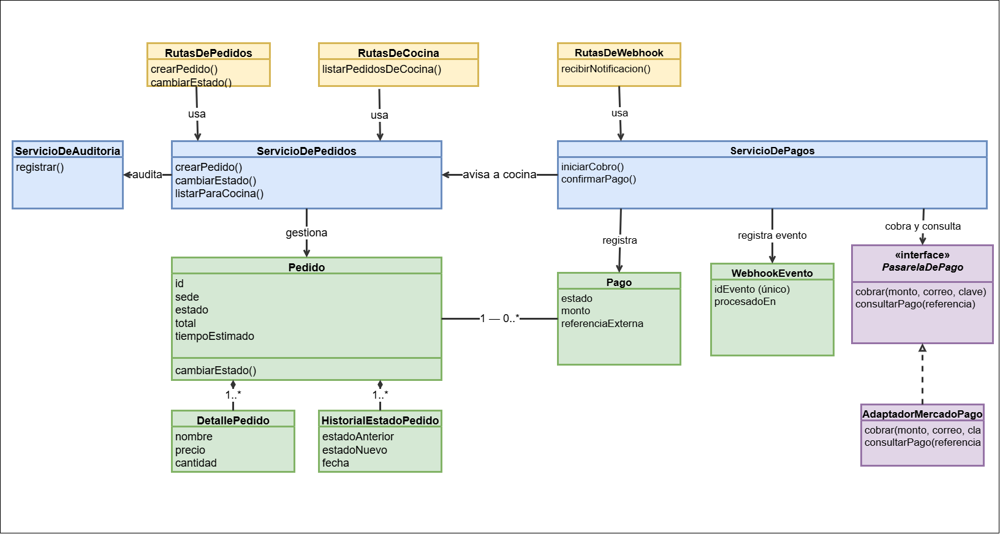

# Nivel 4 · Diagrama de código

> **Proyecto:** Raíz Andina · **Módulo detallado:** flujo pedido → pago → cocina · **Modelo:** C4 · Nivel 4 de 4 · **Notación:** UML

## 1. Objetivo

Mostrar cómo se organizan las clases de los componentes Pedidos, Pagos y Panel de Cocina del nivel 3, que forman el flujo central del sistema.

| Aspecto | Descripción |
|---|---|
| Nivel anterior | `Nivel3-Diagrama-de-Componentes.md` |
| Por qué este flujo | Concentra las reglas más importantes: precios congelados, pago sin duplicados y estados del pedido. |
| Detalle completo | `docs/03-diseno-de-software/diseno-interno/diseno-interno-de-modulos.md` |

## 2. Diagrama

## 3. Clases por capa

| Capa | Clases | Regla |
|---|---|---|
| Rutas | `RutasDePedidos`, `RutasDeCocina`, `RutasDeWebhook` | Reciben la petición, aplican el control de acceso y llaman al servicio. |
| Servicios | `ServicioDePedidos`, `ServicioDePagos`, `ServicioDeAuditoria` | Contienen las reglas de negocio de cada operación. |
| Contrato | `PasarelaDePago` (interfaz) | Define lo que el servicio necesita de una pasarela: cobrar y consultar el estado de un pago. |
| Adaptador | `AdaptadorMercadoPago` | Cumple el contrato `PasarelaDePago` con Mercado Pago. |
| Modelos | `Pedido`, `DetallePedido`, `Pago`, `WebhookEvento`, `HistorialEstadoPedido` | Guardan los datos del flujo. |

## 4. Clases principales

| Clase | Atributos principales | Operaciones principales |
|---|---|---|
| `Pedido` | id, sede, estado, total, tiempo estimado | Cambiar de estado solo hacia adelante |
| `DetallePedido` | nombre y precio del momento, cantidad | – |
| `Pago` | estado (`PENDIENTE`, `CONFIRMADO`, `FALLIDO`), monto, referencia externa | – |
| `WebhookEvento` | identificador del evento (único), fecha de procesamiento | – |
| `PasarelaDePago` | – | `cobrar(monto, correo, claveIdempotencia)`, `consultarPago(referencia)` |
| `ServicioDePedidos` | – | `crearPedido`, `cambiarEstado`, `listarParaCocina` |
| `ServicioDePagos` | – | `iniciarCobro`, `confirmarPago` |

## 5. Notación UML utilizada

| Símbolo | Significado | Ejemplo |
|---|---|---|
| Línea discontinua + triángulo hueco | Realización: implementa una interfaz | `AdaptadorMercadoPago` ▷ `PasarelaDePago` |
| Línea continua + flecha abierta | Asociación: usa a otra clase | `ServicioDePagos` → `PasarelaDePago` |
| Rombo relleno | Composición: una clase contiene a otra | `Pedido` ◆ `DetallePedido` |
| Nombre con «interface» | Interfaz | `PasarelaDePago` |

## 6. Secuencia: del pedido a la cocina

El detalle paso a paso (crear pedido con precios congelados, cobrar, recibir el webhook, confirmar el pago y avisar a la cocina) está documentado en `docs/03-diseno-de-software/diseno-interno/diseno-interno-de-modulos.md`, sección "Flujo: del pedido a la cocina".

## 7. Patrones y principios que se ven en este nivel

| Elemento | Patrón o principio |
|---|---|
| `AdaptadorMercadoPago` y `PasarelaDePago` | Adapter y Strategy |
| `WebhookEvento` con identificador único | Receptor idempotente |
| `Pedido` con cambio de estado solo hacia adelante | Máquina de estados |
| `ServicioDePagos` depende de `PasarelaDePago` y no del proveedor | Inversión de dependencias (SOLID) |
| Las rutas solo llaman a los servicios | Capa de servicios |

Detalle completo en `docs/03-diseno-de-software/diseno-interno/patrones-de-diseno.md` y `principios-de-diseno.md`.